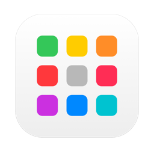
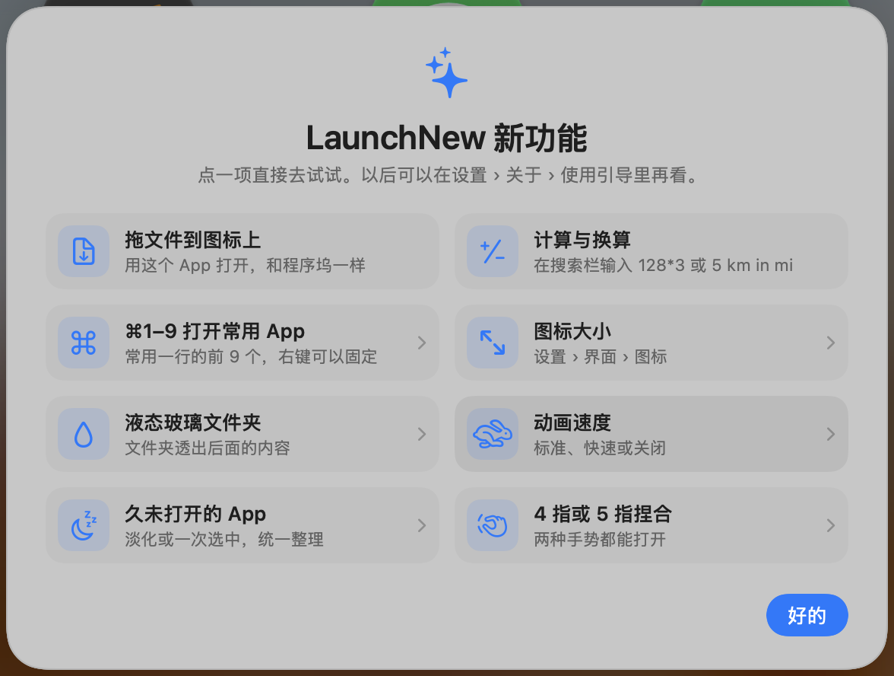
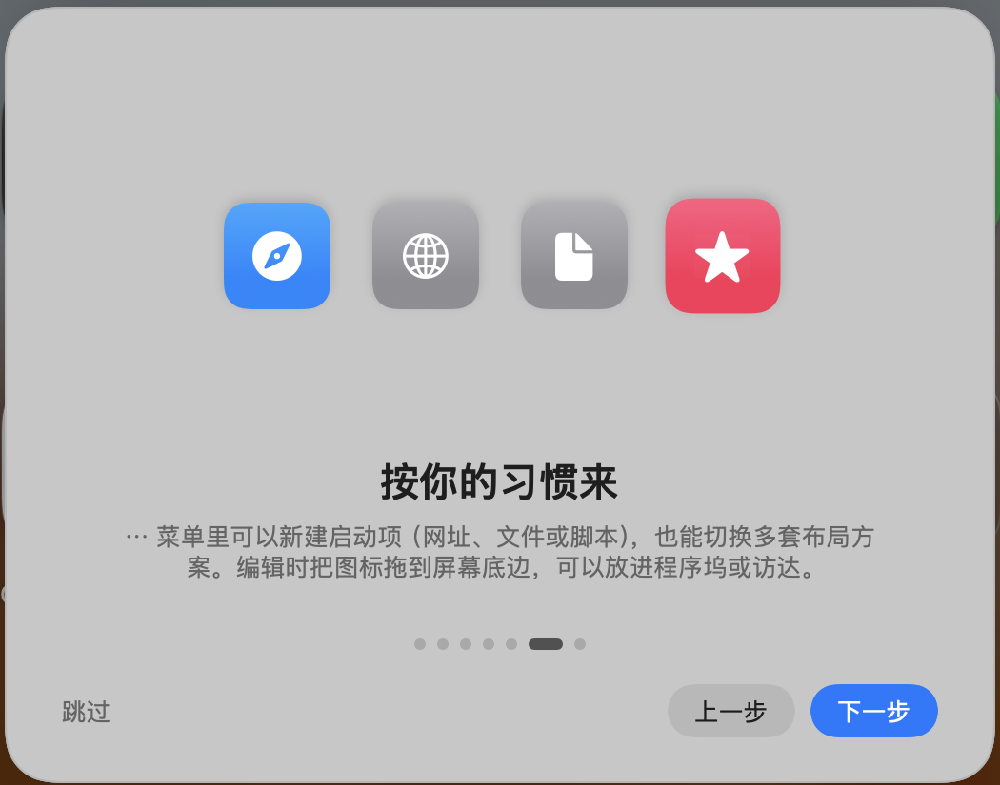

<div align="center">



# LaunchNew

**おなじみの Launchpad を macOS 26 に。ずっと無料。**

[](https://github.com/baka9981/LaunchNew/releases/latest)


[](https://github.com/baka9981/LaunchNew/releases)
[](LICENSE)

<a href="README.md">English</a> · <a href="README.zh-CN.md">简体中文</a> · <a href="README.zh-TW.md">繁體中文</a> · <a href="README.ja.md">日本語</a>

 

</div>

## なぜ作ったか

macOS 26 では Launchpad が「アプリ」ウインドウに置き換わりました。LaunchNew は、ページ、フォルダ、ドラッグで並べ替え、入力して検索といったおなじみのフルスクリーングリッドを取り戻し、Launchpad になかった機能も加えます。

## 機能

| | |
|---|---|
| 🚀 **Launchpad そのまま** | ぼかし背景のフルスクリーングリッド、ページ、フォルダ、編集モード。⌥Space / F4 / トラックパッドのピンチ / ホットコーナーで開く |
| 🔎 **賢い検索** | ピンイン・頭文字、別名、`#タグ`、スマートフォルダ |
| 🧩 **カスタム項目** | Web サイト、ファイル、フォルダ、スクリプトを App のように配置 |
| 🎨 **自分好みに** | アイコン変更、好きな背景画像、ウインドウ／フルスクリーン、行数・列数 |
| 🗂 **レイアウト** | 仕事用と趣味用でページを分け、メニュー・リンク・ショートカットで切り替え |
| 🔔 **リアルタイム表示** | Dock の通知バッジ、起動中インジケータ、最近使った App の列 |
| 🧹 **きれいにアンインストール** | `~/Library` の残りファイルもまとめてゴミ箱へ |
| 🔒 **プライバシー** | Touch ID で App を隠す、レイアウトの自動バックアップ、iCloud 同期（任意） |
| ⚡️ **ショートカットとリンク** | フォルダを開く、検索、レイアウト切り替え。`launchnew://` に対応 |
| 🔄 **自動アップデート** | Sparkle による署名付きアップデート |

## インストール

1. [最新リリース](https://github.com/baka9981/LaunchNew/releases/latest) から **LaunchNew-x.y.z.zip** をダウンロードし、`LaunchNew.app` を「アプリケーション」に移動します。
2. 初回起動時に開発元を確認できないと表示されたら、**システム設定 › プライバシーとセキュリティ** で **このまま開く** をクリックします。
3. **⌥Space** で開きます。何もないところを右クリックするか **⌘,** で設定を開きます。

macOS 26 以降が必要です。

## ソースからビルド

```bash
git clone https://github.com/baka9981/LaunchNew.git
cd LaunchNew
./scripts/run.sh
```

テスト、デバッグ、リリースについては [docs/DEVELOPMENT.md](docs/DEVELOPMENT.md) を参照してください。

## プライバシー

アカウントも解析もなく、アップデートの確認以外に通信しません。レイアウトは `~/Library/Application Support/LaunchNew` に保存され、他の App のデータ（システムの Launchpad データベースを含む）は読み取るだけで書き込みません。

## 無料

LaunchNew は完全に無料です。Pro 版、サブスクリプション、広告はありません。


## ライセンス

[MIT](LICENSE)
