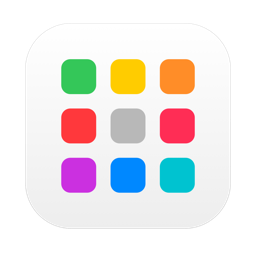
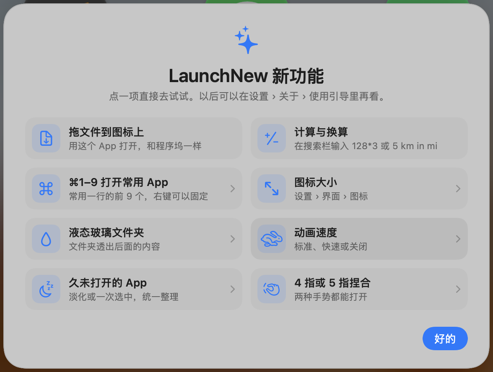
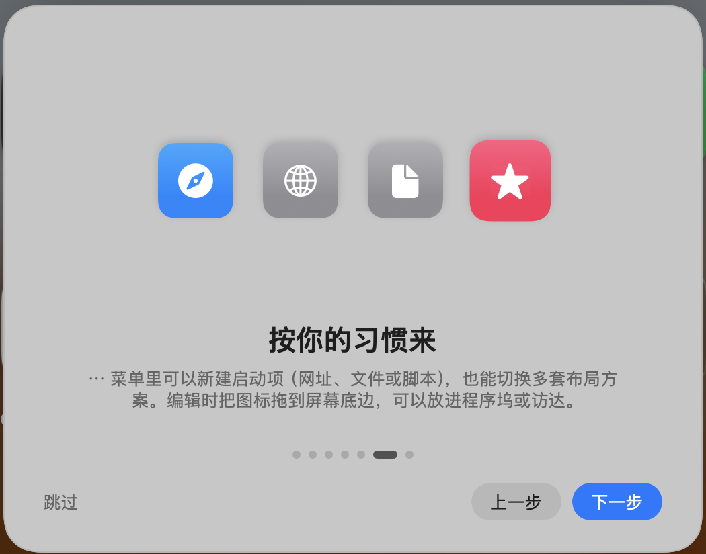

<div align="center">



# LaunchNew

**经典启动台，回到 macOS 26。永久免费。**

[](https://github.com/baka9981/LaunchNew/releases/latest)


[](https://github.com/baka9981/LaunchNew/releases)

<a href="README.md">English</a> · <a href="README.zh-CN.md">简体中文</a> · <a href="README.zh-TW.md">繁體中文</a> · <a href="README.ja.md">日本語</a>

 

</div>

## 为什么做它

macOS 26 用「应用程序」窗口替换了启动台。LaunchNew 把熟悉的全屏网格找回来——翻页、文件夹、拖动整理、打字搜索——再补上启动台从来没有的功能。

## 功能

| | |
|---|---|
| 🚀 **原汁原味** | 全屏模糊网格、翻页、文件夹、抖动模式；⌥Space / F4 / 触控板捏合 / 触发角唤起 |
| 🔎 **更聪明的搜索** | 拼音和首字母（`wx` → 微信）、别名、`#标签`、智能文件夹 |
| 🧩 **自定义启动项** | 网址、文件、文件夹、脚本，像 App 一样放在网格里 |
| 🎨 **按你的习惯来** | 更换任意图标、自选背景图片、窗口或全屏模式、自定义行列数 |
| 🗂 **布局方案** | 工作、娱乐各一套页面，从菜单、链接或快捷指令切换 |
| 🔔 **实时状态** | 程序坞通知角标、运行指示、常用一行 |
| 🧹 **干净卸载** | 连同 `~/Library` 里的残留一起移到废纸篓 |
| 🔒 **隐私安全** | 隐藏 App（Touch ID 验证）、自动备份布局、可选 iCloud 同步 |
| ⚡️ **快捷指令与链接** | 打开文件夹、搜索、切换布局；支持 `launchnew://` |
| 🔄 **自动更新** | 通过 Sparkle 推送签名更新 |

## 安装

1. 从 [最新版本](https://github.com/baka9981/LaunchNew/releases/latest) 下载 **LaunchNew-x.y.z.zip**，把 `LaunchNew.app` 拖进「应用程序」。
2. 首次打开如果提示无法验证开发者：打开 **系统设置 › 隐私与安全性**，点 **仍要打开**。
3. 按 **⌥Space** 打开。右键空白处或按 **⌘,** 进入设置。

需要 macOS 26 或更高版本。

## 从源码构建

```bash
git clone https://github.com/baka9981/LaunchNew.git
cd LaunchNew
./scripts/run.sh
```

测试、调试与发布见 [docs/DEVELOPMENT.md](docs/DEVELOPMENT.md)。

## 隐私

没有账号、没有统计，除了检查更新不联网。布局保存在 `~/Library/Application Support/LaunchNew`；其他 App 的数据（包括系统启动台数据库）只读不写。

## 免费

LaunchNew 完全免费：没有 Pro 版、没有订阅、没有广告。


## 许可证

[MIT](LICENSE)
